 

  <b>Illustration, design & frontend development.</b> 
  I make things look good. Then I make them work.

  <a href="https://deeli.me">Portfolio</a>
  &nbsp; / &nbsp;
  <a href="https://youtube.com/@Deeeli">YouTube</a>
  &nbsp; / &nbsp;
  <a href="https://github.com/ItsMeDeli">GitHub</a>

 

## Hey, I'm Kamil aka Deeli

I'm a digital artist and frontend developer with a soft spot for clean interfaces, bold visuals and the little details most people won't notice.

I spend most of my time creating **2D & vector illustrations** and turning designs into websites with **React** and **Vue**.

When I'm not doing either, I'm probably messing around with **C#**, **Lua**, or something related to **GTA V**.

 

## What I work with

**01 / Visual & design**

Illustrator · Photoshop · Figma

**02 / Frontend**

React · Vue · JavaScript · HTML · CSS

**03 / Other experiments**

C# · .NET · Lua

 

---

  
    Less noise, more good work. 
    <a href="https://deeli.me"><b>See what I'm making →</b></a>
  

