  <a href="https://deeli.me"><b>portfolio</b></a>
  &nbsp;&nbsp;•&nbsp;&nbsp;
  <a href="https://youtube.com/@Deeeli"><b>youtube</b></a>
  &nbsp;&nbsp;•&nbsp;&nbsp;
  <a href="https://github.com/ItsMeDeli"><b>github</b></a>

---

### Hey, I'm Kamil (Deeli)

I'm a digital artist and fullstack developer. I like building things where design and code actually meet — clean interfaces, solid visuals, and software that feels good to use.

Most of my time goes into **2D vector illustrations** and building web applications with **TypeScript**, **React**, and **Vue**. When I'm away from the browser, I usually tinker with **C#**, **Lua**, and custom scripts or tools for **GTA V**.

---

### What I build with

**01 / Design & Vector**  
Illustrator · Figma · Photoshop

**02 / Fullstack Development**  
TypeScript · JavaScript · React · Vue · HTML & CSS

**03 / Scripting & Modding**  
TypeScript · C# · .NET · Lua · Game modding

---

  
    Less noise, more craft. 
    <a href="https://deeli.me"><b>deeli.me →</b></a>
  

